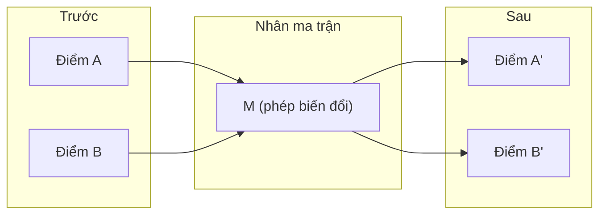
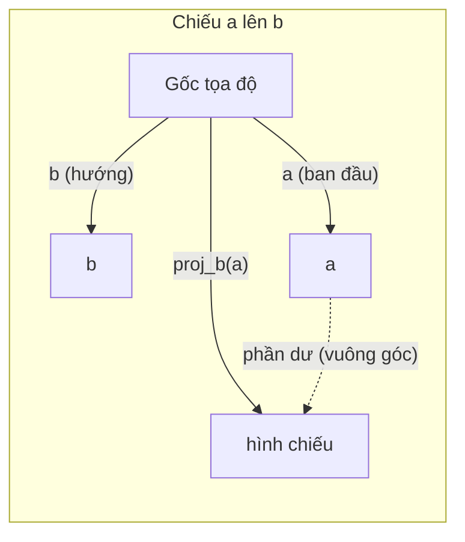

# Trực giác Đại số tuyến tính (Linear Algebra Intuition)

> Mọi mô hình AI suy cho cùng chỉ là phép toán ma trận đội một chiếc mũ sang trọng.

> Bản dịch tiếng Việt của `docs/en.md` để tự học. Thuật ngữ chuyên ngành giữ tiếng Anh trong ngoặc khi cần; code giữ nguyên.

**Loại bài:** Learn
**Ngôn ngữ:** Python, Julia
**Yêu cầu trước:** Phase 0
**Thời gian:** ~60 phút

## Mục tiêu học tập

- Tự cài đặt các phép toán vector và ma trận (cộng, tích vô hướng, nhân ma trận) bằng Python thuần
- Giải thích bằng hình học tích vô hướng (dot product), phép chiếu (projection) và quy trình Gram-Schmidt làm gì
- Xác định tính độc lập tuyến tính, hạng (rank) và cơ sở (basis) của một tập vector bằng phép khử hàng (row reduction)
- Liên hệ các khái niệm đại số tuyến tính với ứng dụng trong AI: embedding, điểm attention và LoRA

## Vấn đề

Mở bất kỳ bài báo ML nào. Ngay trang đầu, bạn sẽ thấy vector, ma trận, tích vô hướng và các phép biến đổi. Không có trực giác đại số tuyến tính, đó chỉ là ký hiệu. Có nó, bạn thấy được mạng nơ-ron thực sự đang làm gì — di chuyển các điểm trong không gian.

Bạn không cần là nhà toán học. Bạn cần thấy các phép toán này có ý nghĩa hình học gì, rồi tự code chúng.

## Khái niệm

### Vector là điểm (và là hướng)

Vector chỉ là một danh sách số. Nhưng các số đó có ý nghĩa — chúng là tọa độ trong không gian.

**Vector 2D [3, 2]:**

| x | y | Điểm |
|---|---|-------|
| 3 | 2 | Vector đi từ gốc tọa độ (0,0) đến điểm (3, 2) trên mặt phẳng |

Vector này có độ dài (magnitude) sqrt(3^2 + 2^2) = sqrt(13) và chỉ hướng lên trên, sang phải.

Trong AI, vector biểu diễn mọi thứ:
- Một từ → một vector 768 số ("ý nghĩa" của nó trong không gian embedding)
- Một ảnh → một vector hàng triệu giá trị pixel
- Một người dùng → một vector sở thích

### Ma trận là phép biến đổi

Ma trận biến một vector thành vector khác. Nó có thể xoay, co giãn, kéo dãn hoặc chiếu.



Trong AI, ma trận CHÍNH LÀ mô hình:
- Trọng số mạng nơ-ron → các ma trận biến input thành output
- Điểm attention → các ma trận quyết định cần tập trung vào đâu
- Embedding → các ma trận ánh xạ từ thành vector

### Tích vô hướng đo độ tương đồng

Tích vô hướng (dot product) của hai vector cho biết chúng giống nhau đến mức nào.

```text
a · b = a₁×b₁ + a₂×b₂ + ... + aₙ×bₙ

Cùng hướng:          a · b > 0  (tương đồng)
Vuông góc:           a · b = 0  (không liên quan)
Ngược hướng:         a · b < 0  (trái ngược)
```

Đây đúng là cách công cụ tìm kiếm, hệ gợi ý và RAG hoạt động — tìm các vector có tích vô hướng cao.

### Độc lập tuyến tính (Linear Independence)

Các vector độc lập tuyến tính nếu không vector nào trong tập có thể viết thành tổ hợp của các vector còn lại. Nếu v1, v2, v3 độc lập, chúng sinh ra (span) không gian 3D. Nếu một vector là tổ hợp của các vector kia, chúng chỉ sinh ra một mặt phẳng.

Vì sao quan trọng với AI: ma trận đặc trưng (feature matrix) nên có các cột độc lập tuyến tính. Nếu hai đặc trưng tương quan hoàn toàn (phụ thuộc tuyến tính), mô hình không phân biệt được tác động của từng cái. Điều này gây ra đa cộng tuyến (multicollinearity) trong hồi quy — ma trận trọng số trở nên bất ổn, thay đổi nhỏ ở input gây dao động lớn ở output.

**Ví dụ cụ thể:**

```text
v1 = [1, 0, 0]
v2 = [0, 1, 0]
v3 = [2, 1, 0]   # v3 = 2*v1 + v2
```

v1 và v2 độc lập — không cái nào là bội số hay tổ hợp của cái kia. Nhưng v3 = 2*v1 + v2, nên {v1, v2, v3} là tập phụ thuộc. Cả ba vector đều nằm trong mặt phẳng xy. Dù tổ hợp thế nào, bạn cũng không đạt được [0, 0, 1]. Bạn có ba vector nhưng chỉ có hai chiều tự do.

Trong một tập dữ liệu: nếu feature_3 = 2*feature_1 + feature_2, thêm feature_3 không cho mô hình thông tin mới nào. Tệ hơn, nó làm hệ phương trình chuẩn (normal equations) suy biến (singular) — không có nghiệm trọng số duy nhất.

### Cơ sở và Hạng (Basis and Rank)

Cơ sở là một tập tối thiểu các vector độc lập tuyến tính sinh ra toàn bộ không gian. Số vector trong cơ sở là số chiều của không gian.

Cơ sở chuẩn của không gian 3D là {[1,0,0], [0,1,0], [0,0,1]}. Nhưng bất kỳ ba vector độc lập nào trong 3D cũng tạo thành một cơ sở hợp lệ. Chọn cơ sở chính là chọn hệ tọa độ.

Hạng của ma trận = số cột độc lập tuyến tính = số hàng độc lập tuyến tính. Nếu rank < min(số hàng, số cột), ma trận bị thiếu hạng (rank-deficient). Nghĩa là:
- Hệ phương trình có vô số nghiệm (hoặc vô nghiệm)
- Thông tin bị mất trong phép biến đổi
- Ma trận không khả nghịch

| Tình huống | Hạng | Ý nghĩa với ML |
|-----------|------|---------------------|
| Đủ hạng (rank = min(m, n)) | Lớn nhất có thể | Tồn tại nghiệm bình phương tối thiểu duy nhất. Mô hình có điều kiện tốt (well-conditioned). |
| Thiếu hạng (rank < min(m, n)) | Dưới mức tối đa | Đặc trưng bị thừa. Vô số nghiệm trọng số. Cần regularization. |
| Hạng 1 | 1 | Mọi cột là bản co giãn của một vector. Mọi dữ liệu nằm trên một đường thẳng. |
| Gần thiếu hạng (giá trị suy biến nhỏ) | Thấp về mặt số học | Ma trận có điều kiện xấu (ill-conditioned). Nhiễu nhỏ ở input gây thay đổi lớn ở output. Dùng SVD cắt bớt hoặc ridge regression. |

### Phép chiếu (Projection)

Chiếu vector **a** lên vector **b** cho ta thành phần của **a** theo hướng **b**:

```text
proj_b(a) = (a dot b / b dot b) * b
```

Phần dư (a - proj_b(a)) vuông góc với b. Phép phân tích trực giao này là nền tảng của khớp bình phương tối thiểu (least-squares fitting).

Phép chiếu có mặt khắp nơi trong ML:
- Hồi quy tuyến tính tối thiểu hóa khoảng cách từ các quan sát đến không gian cột — nghiệm CHÍNH LÀ một phép chiếu
- PCA chiếu dữ liệu lên các hướng có phương sai lớn nhất
- Attention trong transformer tính phép chiếu của query lên key



**Ví dụ:** a = [3, 4], b = [1, 0]

proj_b(a) = (3*1 + 4*0) / (1*1 + 0*0) * [1, 0] = 3 * [1, 0] = [3, 0]

Phép chiếu bỏ đi thành phần y. Đây là giảm chiều (dimensionality reduction) ở dạng đơn giản nhất — vứt bỏ những hướng bạn không quan tâm.

### Quy trình Gram-Schmidt

Biến một tập vector độc lập bất kỳ thành một cơ sở trực chuẩn (orthonormal basis). Trực chuẩn nghĩa là mọi vector có độ dài 1 và mọi cặp đều vuông góc.

Thuật toán:
1. Lấy vector thứ nhất, chuẩn hóa nó
2. Lấy vector thứ hai, trừ đi hình chiếu của nó lên vector thứ nhất, chuẩn hóa
3. Lấy vector thứ ba, trừ đi hình chiếu của nó lên tất cả các vector trước, chuẩn hóa
4. Lặp lại với các vector còn lại

```text
Input:  v1, v2, v3, ... (độc lập tuyến tính)

u1 = v1 / |v1|

w2 = v2 - (v2 dot u1) * u1
u2 = w2 / |w2|

w3 = v3 - (v3 dot u1) * u1 - (v3 dot u2) * u2
u3 = w3 / |w3|

Output: u1, u2, u3, ... (cơ sở trực chuẩn)
```

Đây là cách phân tích QR hoạt động bên trong. Q là cơ sở trực chuẩn, R lưu các hệ số chiếu. Phân tích QR được dùng trong:
- Giải hệ phương trình tuyến tính (ổn định hơn khử Gauss)
- Tính trị riêng (thuật toán QR)
- Hồi quy bình phương tối thiểu (phương pháp số tiêu chuẩn)

```figure
eigen-directions
```

## Tự xây dựng (Build It)

### Bước 1: Vector từ đầu (Python)

```python
class Vector:
    def __init__(self, components):
        self.components = list(components)
        self.dim = len(self.components)

    def __add__(self, other):
        return Vector([a + b for a, b in zip(self.components, other.components)])

    def __sub__(self, other):
        return Vector([a - b for a, b in zip(self.components, other.components)])

    def dot(self, other):
        return sum(a * b for a, b in zip(self.components, other.components))

    def magnitude(self):
        return sum(x**2 for x in self.components) ** 0.5

    def normalize(self):
        mag = self.magnitude()
        return Vector([x / mag for x in self.components])

    def cosine_similarity(self, other):
        return self.dot(other) / (self.magnitude() * other.magnitude())

    def __repr__(self):
        return f"Vector({self.components})"


a = Vector([1, 2, 3])
b = Vector([4, 5, 6])

print(f"a + b = {a + b}")
print(f"a · b = {a.dot(b)}")
print(f"|a| = {a.magnitude():.4f}")
print(f"cosine similarity = {a.cosine_similarity(b):.4f}")
```

### Bước 2: Ma trận từ đầu (Python)

```python
class Matrix:
    def __init__(self, rows):
        self.rows = [list(row) for row in rows]
        self.shape = (len(self.rows), len(self.rows[0]))

    def __matmul__(self, other):
        if isinstance(other, Vector):
            return Vector([
                sum(self.rows[i][j] * other.components[j] for j in range(self.shape[1]))
                for i in range(self.shape[0])
            ])
        rows = []
        for i in range(self.shape[0]):
            row = []
            for j in range(other.shape[1]):
                row.append(sum(
                    self.rows[i][k] * other.rows[k][j]
                    for k in range(self.shape[1])
                ))
            rows.append(row)
        return Matrix(rows)

    def transpose(self):
        return Matrix([
            [self.rows[j][i] for j in range(self.shape[0])]
            for i in range(self.shape[1])
        ])

    def __repr__(self):
        return f"Matrix({self.rows})"


rotation_90 = Matrix([[0, -1], [1, 0]])
point = Vector([3, 1])

rotated = rotation_90 @ point
print(f"Original: {point}")
print(f"Rotated 90°: {rotated}")
```

### Bước 3: Vì sao điều này quan trọng với AI

```python
import random

random.seed(42)
weights = Matrix([[random.gauss(0, 0.1) for _ in range(3)] for _ in range(2)])
input_vector = Vector([1.0, 0.5, -0.3])

output = weights @ input_vector
print(f"Input (3D): {input_vector}")
print(f"Output (2D): {output}")
print("This is what a neural network layer does -- matrix multiplication.")
```

Một lớp mạng nơ-ron làm đúng việc này — nhân ma trận: input 3 chiều đi vào, output 2 chiều đi ra.

### Bước 4: Phiên bản Julia

```julia
a = [1.0, 2.0, 3.0]
b = [4.0, 5.0, 6.0]

println("a + b = ", a + b)
println("a · b = ", a ⋅ b)       # Julia supports unicode operators
println("|a| = ", √(a ⋅ a))
println("cosine = ", (a ⋅ b) / (√(a ⋅ a) * √(b ⋅ b)))

# Matrix-vector multiplication
W = [0.1 -0.2 0.3; 0.4 0.5 -0.1]
x = [1.0, 0.5, -0.3]
println("Wx = ", W * x)
println("This is a neural network layer.")
```

### Bước 5: Độc lập tuyến tính và phép chiếu từ đầu (Python)

```python
def is_linearly_independent(vectors):
    n = len(vectors)
    dim = len(vectors[0].components)
    mat = Matrix([v.components[:] for v in vectors])
    rows = [row[:] for row in mat.rows]
    rank = 0
    for col in range(dim):
        pivot = None
        for row in range(rank, len(rows)):
            if abs(rows[row][col]) > 1e-10:
                pivot = row
                break
        if pivot is None:
            continue
        rows[rank], rows[pivot] = rows[pivot], rows[rank]
        scale = rows[rank][col]
        rows[rank] = [x / scale for x in rows[rank]]
        for row in range(len(rows)):
            if row != rank and abs(rows[row][col]) > 1e-10:
                factor = rows[row][col]
                rows[row] = [rows[row][j] - factor * rows[rank][j] for j in range(dim)]
        rank += 1
    return rank == n


def project(a, b):
    scalar = a.dot(b) / b.dot(b)
    return Vector([scalar * x for x in b.components])


def gram_schmidt(vectors):
    orthonormal = []
    for v in vectors:
        w = v
        for u in orthonormal:
            proj = project(w, u)
            w = w - proj
        if w.magnitude() < 1e-10:
            continue
        orthonormal.append(w.normalize())
    return orthonormal


v1 = Vector([1, 0, 0])
v2 = Vector([1, 1, 0])
v3 = Vector([1, 1, 1])
basis = gram_schmidt([v1, v2, v3])
for i, u in enumerate(basis):
    print(f"u{i+1} = {u}")
    print(f"  |u{i+1}| = {u.magnitude():.6f}")

print(f"u1 · u2 = {basis[0].dot(basis[1]):.6f}")
print(f"u1 · u3 = {basis[0].dot(basis[2]):.6f}")
print(f"u2 · u3 = {basis[1].dot(basis[2]):.6f}")
```

## Dùng thư viện (Use It)

Giờ làm lại với NumPy — thứ bạn thực sự dùng khi làm việc:

```python
import numpy as np

a = np.array([1, 2, 3], dtype=float)
b = np.array([4, 5, 6], dtype=float)

print(f"a + b = {a + b}")
print(f"a · b = {np.dot(a, b)}")
print(f"|a| = {np.linalg.norm(a):.4f}")
print(f"cosine = {np.dot(a, b) / (np.linalg.norm(a) * np.linalg.norm(b)):.4f}")

W = np.random.randn(2, 3) * 0.1
x = np.array([1.0, 0.5, -0.3])
print(f"Wx = {W @ x}")
```

### Hạng, phép chiếu và QR với NumPy

```python
import numpy as np

A = np.array([[1, 2], [2, 4]])
print(f"Rank: {np.linalg.matrix_rank(A)}")

a = np.array([3, 4])
b = np.array([1, 0])
proj = (np.dot(a, b) / np.dot(b, b)) * b
print(f"Projection of {a} onto {b}: {proj}")

Q, R = np.linalg.qr(np.random.randn(3, 3))
print(f"Q is orthogonal: {np.allclose(Q @ Q.T, np.eye(3))}")
print(f"R is upper triangular: {np.allclose(R, np.triu(R))}")
```

### PyTorch — Tensor là vector có kèm autodiff

```python
import torch

x = torch.randn(3, requires_grad=True)
y = torch.tensor([1.0, 0.0, 0.0])

similarity = torch.dot(x, y)
similarity.backward()

print(f"x = {x.data}")
print(f"y = {y.data}")
print(f"dot product = {similarity.item():.4f}")
print(f"d(dot)/dx = {x.grad}")
```

Gradient của tích vô hướng theo x chính là y. PyTorch tự tính điều này. Mọi phép toán trong mạng nơ-ron đều được xây từ những phép như vậy — nhân ma trận, tích vô hướng, phép chiếu — và autodiff theo dõi gradient qua tất cả chúng.

Bạn vừa tự xây từ đầu thứ mà NumPy làm trong một dòng. Giờ bạn biết bên dưới đang xảy ra gì.

## Sản phẩm (Ship It)

Bài này tạo ra:
- `outputs/prompt-linear-algebra-tutor.md` — một prompt để trợ lý AI dạy đại số tuyến tính qua trực giác hình học

## Liên hệ

Mọi thứ trong bài này gắn với các phần cụ thể của AI hiện đại:

| Khái niệm | Xuất hiện ở đâu |
|---------|------------------|
| Tích vô hướng | Điểm attention trong transformer, cosine similarity trong RAG |
| Nhân ma trận | Mọi lớp mạng nơ-ron, mọi phép biến đổi tuyến tính |
| Độc lập tuyến tính | Chọn đặc trưng, tránh đa cộng tuyến |
| Hạng | Xác định hệ có giải được không, LoRA (low-rank adaptation) |
| Phép chiếu | Hồi quy tuyến tính (chiếu lên không gian cột), PCA |
| Gram-Schmidt / QR | Bộ giải số, tính trị riêng |
| Cơ sở trực chuẩn | Tính toán số ổn định, phép biến đổi whitening |

LoRA đáng được nhắc riêng. Nó fine-tune các mô hình ngôn ngữ lớn bằng cách phân tích cập nhật trọng số thành các ma trận hạng thấp. Thay vì cập nhật một ma trận trọng số 4096x4096 (16 triệu tham số), LoRA cập nhật hai ma trận kích thước 4096x16 và 16x4096 (131 nghìn tham số). Ràng buộc hạng 16 nghĩa là LoRA giả định cập nhật trọng số nằm trong một không gian con 16 chiều của toàn bộ không gian 4096 chiều. Đó là đại số tuyến tính làm việc thật.

## Bài tập

1. Cài đặt `Vector.angle_between(other)` trả về góc (đơn vị độ) giữa hai vector
2. Tạo ma trận co giãn 2D nhân đôi tọa độ x và nhân ba tọa độ y, rồi áp dụng lên vector [1, 1]
3. Cho 5 vector ngẫu nhiên giống vector từ (50 chiều), tìm hai vector giống nhau nhất bằng cosine similarity
4. Kiểm chứng output của Gram-Schmidt thực sự trực chuẩn: mọi cặp có tích vô hướng bằng 0 và mọi vector có độ dài 1
5. Tạo một ma trận 3x3 có hạng 2. Kiểm chứng bằng phương thức `rank()`. Rồi giải thích các cột sinh ra vật thể hình học gì.
6. Chiếu vector [1, 2, 3] lên [1, 1, 1]. Về mặt hình học, kết quả biểu diễn điều gì?

## Thuật ngữ chính

| Thuật ngữ | Người ta hay nói | Thực chất nghĩa là |
|------|----------------|----------------------|
| Vector | "Một mũi tên" | Một danh sách số biểu diễn một điểm hoặc một hướng trong không gian n chiều |
| Matrix (ma trận) | "Một bảng số" | Một phép biến đổi ánh xạ vector từ không gian này sang không gian khác |
| Dot product (tích vô hướng) | "Nhân rồi cộng" | Thước đo mức độ cùng hướng của hai vector — cốt lõi của tìm kiếm tương đồng |
| Embedding | "Phép màu AI nào đó" | Một vector biểu diễn ý nghĩa của một thứ gì đó (từ, ảnh, người dùng) |
| Linear independence (độc lập tuyến tính) | "Chúng không trùng nhau" | Không vector nào trong tập viết được thành tổ hợp của các vector còn lại |
| Rank (hạng) | "Bao nhiêu chiều" | Số cột (hoặc hàng) độc lập tuyến tính trong ma trận |
| Projection (phép chiếu) | "Cái bóng" | Thành phần của một vector theo hướng của vector khác |
| Basis (cơ sở) | "Các trục tọa độ" | Một tập tối thiểu các vector độc lập sinh ra không gian |
| Orthonormal (trực chuẩn) | "Các vector đơn vị vuông góc" | Các vector đôi một vuông góc và mỗi vector có độ dài 1 |
