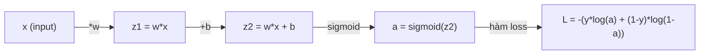
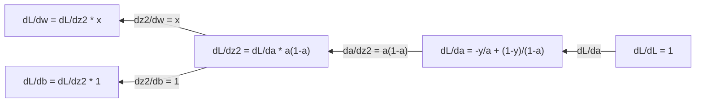
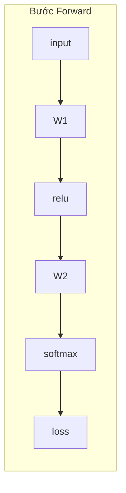
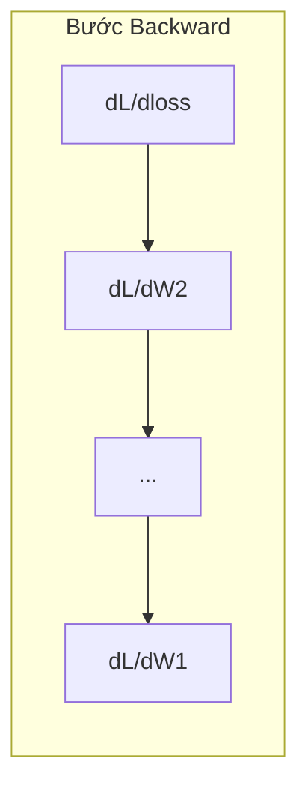

# Giải tích cho Machine Learning (Calculus for ML)

> Đạo hàm cho bạn biết hướng nào là xuống dốc. Mạng nơ-ron chỉ cần có vậy để học.

> Bản dịch tiếng Việt của `docs/en.md` để tự học. Thuật ngữ chuyên ngành giữ tiếng Anh trong ngoặc khi cần; code giữ nguyên.

**Loại bài:** Learn
**Ngôn ngữ:** Python
**Yêu cầu trước:** Phase 1, Bài 01-03
**Thời gian:** ~60 phút

## Mục tiêu học tập

- Tính đạo hàm bằng số (numerical) và bằng công thức (analytical) cho các hàm ML phổ biến (x^2, sigmoid, cross-entropy)
- Tự cài đặt gradient descent để tối thiểu hóa hàm loss trong 1D và 2D
- Suy ra gradient của mô hình hồi quy tuyến tính và huấn luyện nó bằng cách tự cập nhật trọng số
- Giải thích ma trận Hessian, xấp xỉ chuỗi Taylor và mối liên hệ của chúng với các phương pháp tối ưu

## Vấn đề

Bạn có một mạng nơ-ron với hàng triệu trọng số. Mỗi trọng số là một núm vặn. Bạn cần biết nên vặn từng núm theo hướng nào để mô hình bớt sai một chút. Giải tích cho bạn hướng đó.

Không có giải tích, huấn luyện mạng nơ-ron nghĩa là thử thay đổi ngẫu nhiên rồi cầu may. Có đạo hàm, bạn biết chính xác mỗi trọng số ảnh hưởng tới sai số thế nào. Bạn vặn mọi núm đúng hướng, lần nào cũng vậy.

## Khái niệm

### Đạo hàm là gì?

Đạo hàm đo tốc độ thay đổi. Với hàm y = f(x), đạo hàm f'(x) cho biết: nếu bạn nhích x một lượng rất nhỏ, y thay đổi bao nhiêu?

Về hình học, đạo hàm là hệ số góc (độ dốc) của tiếp tuyến tại một điểm.

**f(x) = x^2:**

| x | f(x) | f'(x) (độ dốc) |
|---|------|---------------|
| 0 | 0    | 0 (phẳng, ở đáy) |
| 1 | 1    | 2 |
| 2 | 4    | 4 (độ dốc tiếp tuyến tại điểm này) |
| 3 | 9    | 6 |

Tại x=2, độ dốc là 4. Nếu bạn dịch x sang phải một chút, y tăng khoảng 4 lần lượng đó. Tại x=0, độ dốc bằng 0. Bạn đang ở đáy cái bát.

Định nghĩa chính thức:

```text
f'(x) = lim   f(x + h) - f(x)
        h->0  -----------------
                     h
```

Trong code, bạn bỏ qua giới hạn và chỉ dùng một h rất nhỏ. Đó là đạo hàm số (numerical derivative).

### Đạo hàm riêng: từng biến một

Hàm thực tế có nhiều input. Loss của mạng nơ-ron phụ thuộc vào hàng nghìn trọng số. Đạo hàm riêng (partial derivative) giữ mọi biến cố định trừ một biến, rồi lấy đạo hàm theo biến đó.

```text
f(x, y) = x^2 + 3xy + y^2

df/dx = 2x + 3y     (coi y là hằng số)
df/dy = 3x + 2y     (coi x là hằng số)
```

Mỗi đạo hàm riêng trả lời câu hỏi: nếu tôi chỉ nhích đúng trọng số này, loss thay đổi thế nào?

### Gradient: vector của mọi đạo hàm riêng

Gradient gom mọi đạo hàm riêng vào một vector. Với hàm f(x, y, z), gradient là:

```text
grad f = [ df/dx, df/dy, df/dz ]
```

Gradient chỉ theo hướng tăng nhanh nhất (dốc lên nhất). Để tối thiểu hóa hàm, đi theo hướng ngược lại.

**Đường đồng mức của f(x,y) = x^2 + y^2:**

Hàm này có dạng cái bát, với các đường đồng mức là những vòng tròn đồng tâm. Điểm cực tiểu ở (0, 0).

| Điểm | grad f | -grad f (hướng đi xuống) |
|-------|--------|----------------------------|
| (1, 1) | [2, 2] (chỉ lên dốc, ra xa cực tiểu) | [-2, -2] (chỉ xuống dốc, về phía cực tiểu) |
| (0, 0) | [0, 0] (phẳng, tại cực tiểu) | [0, 0] |

Đây là gradient descent trong một bức tranh. Tính gradient, đổi dấu, bước một bước.

### Liên hệ với tối ưu hóa

Huấn luyện mạng nơ-ron là bài toán tối ưu. Bạn có hàm loss L(w1, w2, ..., wn) đo mô hình sai bao nhiêu. Bạn muốn tối thiểu hóa nó.

```text
Quy tắc cập nhật gradient descent:

  w_new = w_old - learning_rate * dL/dw

Với mỗi trọng số:
  1. Tính đạo hàm riêng của loss theo trọng số đó
  2. Trừ đi một bội số nhỏ của nó khỏi trọng số
  3. Lặp lại
```

Learning rate điều khiển độ dài bước. Quá lớn thì vượt quá đích. Quá nhỏ thì bò rất chậm.

**Địa hình loss (lát cắt 1D):**

Hàm loss L(w) tạo thành một đường cong có đỉnh và thung lũng khi trọng số w thay đổi.

| Đặc điểm | Mô tả |
|---------|-------------|
| Cực tiểu toàn cục (global minimum) | Điểm thấp nhất trên toàn bộ đường cong — nghiệm tốt nhất |
| Cực tiểu cục bộ (local minimum) | Một thung lũng thấp hơn các điểm lân cận nhưng không phải thấp nhất tổng thể |
| Độ dốc | Gradient descent đi theo độ dốc xuống từ bất kỳ điểm xuất phát nào |

Gradient descent đi theo độ dốc xuống dưới. Nó có thể kẹt ở cực tiểu cục bộ, nhưng trong không gian nhiều chiều (hàng triệu trọng số) điều này hiếm khi là vấn đề thực tế.

### Đạo hàm số và đạo hàm giải tích

Có hai cách tính đạo hàm.

Giải tích (analytical): áp dụng quy tắc giải tích bằng tay. Với f(x) = x^2, đạo hàm là f'(x) = 2x. Chính xác. Nhanh.

Số (numerical): xấp xỉ bằng định nghĩa. Tính f(x+h) và f(x-h) với h rất nhỏ, rồi lấy hiệu.

```text
Đạo hàm số (sai phân trung tâm - central difference):

f'(x) ~= f(x + h) - f(x - h)
          -----------------------
                  2h

h = 0.0001 dùng tốt trong thực tế
```

Đạo hàm số chậm hơn nhưng dùng được cho mọi hàm. Đạo hàm giải tích nhanh nhưng đòi hỏi bạn tự suy ra công thức. Các framework mạng nơ-ron dùng cách thứ ba: vi phân tự động (automatic differentiation), tính đạo hàm chính xác một cách máy móc. Bạn sẽ gặp nó ở Phase 3.

### Đạo hàm bằng tay cho các hàm đơn giản

Đây là những đạo hàm bạn sẽ gặp đi gặp lại trong ML.

```text
Hàm                 Đạo hàm                  Dùng trong
---                 -------                  ----------
f(x) = x^2          f'(x) = 2x               Hàm loss (MSE)
f(x) = wx + b       f'(w) = x                Lớp linear (gradient theo trọng số)
                    f'(b) = 1                Lớp linear (gradient theo bias)
                    f'(x) = w                Lớp linear (gradient theo input)
f(x) = e^x          f'(x) = e^x              Softmax, attention
f(x) = ln(x)        f'(x) = 1/x              Loss cross-entropy
f(x) = 1/(1+e^-x)   f'(x) = f(x)(1-f(x))     Hàm kích hoạt sigmoid
```

Với f(x) = x^2:

```text
f(x) = x^2    f'(x) = 2x

  x    f(x)   f'(x)   ý nghĩa
  -2    4      -4      dốc nghiêng trái (đang giảm)
  -1    1      -2      dốc nghiêng trái (đang giảm)
   0    0       0      phẳng (cực tiểu!)
   1    1       2      dốc nghiêng phải (đang tăng)
   2    4       4      dốc nghiêng phải (đang tăng)
```

Với f(w) = wx + b, x=3, b=1:

```text
f(w) = 3w + 1    f'(w) = 3

Đạo hàm theo w chính là x.
Nếu x lớn, một thay đổi nhỏ ở w gây thay đổi lớn ở output.
```

### Quy tắc dây chuyền (Chain rule)

Khi các hàm lồng vào nhau, quy tắc dây chuyền cho biết cách lấy đạo hàm.

```text
Nếu y = f(g(x)) thì dy/dx = f'(g(x)) * g'(x)

Ví dụ: y = (3x + 1)^2
  hàm ngoài: f(u) = u^2       f'(u) = 2u
  hàm trong: g(x) = 3x + 1    g'(x) = 3
  dy/dx = 2(3x + 1) * 3 = 6(3x + 1)
```

Mạng nơ-ron là chuỗi các hàm: input -> linear -> activation -> linear -> activation -> loss. Backpropagation là quy tắc dây chuyền áp dụng lặp đi lặp lại từ output về input. Đó là toàn bộ thuật toán.

### Ma trận Hessian

Gradient cho bạn độ dốc. Hessian cho bạn độ cong.

Hessian là ma trận các đạo hàm riêng cấp hai. Với hàm f(x1, x2, ..., xn), phần tử (i, j) của Hessian là:

```text
H[i][j] = d^2f / (dx_i * dx_j)
```

Với hàm 2 biến f(x, y):

```text
H = | d^2f/dx^2    d^2f/dxdy |
    | d^2f/dydx    d^2f/dy^2 |
```

**Hessian cho biết gì tại điểm dừng (nơi gradient = 0):**

| Tính chất Hessian | Ý nghĩa | Bề mặt ví dụ |
|-----------------|---------|-----------------|
| Xác định dương (mọi trị riêng > 0) | Cực tiểu cục bộ | Cái bát ngửa lên |
| Xác định âm (mọi trị riêng < 0) | Cực đại cục bộ | Cái bát úp xuống |
| Không xác định (trị riêng trái dấu) | Điểm yên ngựa (saddle point) | Hình yên ngựa |

**Ví dụ:** f(x, y) = x^2 - y^2 (hàm yên ngựa)

```text
df/dx = 2x       df/dy = -2y
d^2f/dx^2 = 2    d^2f/dy^2 = -2    d^2f/dxdy = 0

H = | 2   0 |
    | 0  -2 |

Trị riêng: 2 và -2 (một dương, một âm)
--> Điểm yên ngựa tại (0, 0)
```

So sánh với f(x, y) = x^2 + y^2 (cái bát):

```text
H = | 2  0 |
    | 0  2 |

Trị riêng: 2 và 2 (đều dương)
--> Cực tiểu cục bộ tại (0, 0)
```

**Vì sao Hessian quan trọng trong ML:**

Phương pháp Newton dùng Hessian để bước tối ưu tốt hơn gradient descent. Thay vì chỉ đi theo độ dốc, nó tính đến độ cong:

```text
Cập nhật Newton:      w_new = w_old - H^(-1) * gradient
Gradient descent:     w_new = w_old - lr * gradient
```

Phương pháp Newton hội tụ nhanh hơn vì Hessian "co giãn lại" gradient — hướng dốc thì bước ngắn hơn, hướng phẳng thì bước dài hơn.

Vấn đề: với mạng nơ-ron có N tham số, Hessian có kích thước N x N. Một mô hình 1 triệu tham số cần ma trận 1 nghìn tỷ phần tử. Đó là lý do ta dùng các phép xấp xỉ.

| Phương pháp | Dùng gì | Chi phí | Hội tụ |
|--------|-------------|------|-------------|
| Gradient descent | Chỉ đạo hàm cấp một | O(N) mỗi bước | Chậm (tuyến tính) |
| Phương pháp Newton | Toàn bộ Hessian | O(N^3) mỗi bước | Nhanh (bậc hai) |
| L-BFGS | Hessian xấp xỉ từ lịch sử gradient | O(N) mỗi bước | Trung bình (siêu tuyến tính) |
| Adam | Tốc độ thích nghi riêng cho từng tham số (xấp xỉ đường chéo Hessian) | O(N) mỗi bước | Trung bình |
| Natural gradient | Ma trận thông tin Fisher (Hessian thống kê) | O(N^2) mỗi bước | Nhanh |

Trong thực tế, Adam là optimizer mặc định cho deep learning. Nó xấp xỉ thông tin cấp hai một cách rẻ bằng cách theo dõi trung bình động và phương sai của gradient cho từng tham số.

### Xấp xỉ chuỗi Taylor (Taylor Series)

Mọi hàm trơn đều có thể xấp xỉ cục bộ bằng một đa thức:

```text
f(x + h) = f(x) + f'(x)*h + (1/2)*f''(x)*h^2 + (1/6)*f'''(x)*h^3 + ...
```

Càng nhiều số hạng, xấp xỉ càng tốt — nhưng chỉ ở gần điểm x.

**Vì sao chuỗi Taylor quan trọng với ML:**

- **Taylor cấp một = gradient descent.** Khi dùng f(x + h) ~ f(x) + f'(x)*h, bạn đang xấp xỉ tuyến tính. Gradient descent tối thiểu hóa mô hình tuyến tính này để chọn h = -lr * f'(x).

- **Taylor cấp hai = phương pháp Newton.** Dùng f(x + h) ~ f(x) + f'(x)*h + (1/2)*f''(x)*h^2, bạn có mô hình bậc hai. Tối thiểu hóa nó cho h = -f'(x)/f''(x) — bước Newton.

- **Thiết kế hàm loss.** MSE và cross-entropy đều trơn, nghĩa là khai triển Taylor của chúng "ngoan". Đây không phải ngẫu nhiên. Loss trơn giúp quá trình tối ưu dễ dự đoán.

```text
Cấp xấp xỉ              Nắm bắt được        Phương pháp tối ưu
----------              ------------        ------------------
Cấp 0 (hằng số)         Chỉ giá trị         Tìm kiếm ngẫu nhiên
Cấp 1 (tuyến tính)      Độ dốc              Gradient descent
Cấp 2 (bậc hai)         Độ cong             Phương pháp Newton
Cấp cao hơn             Cấu trúc tinh hơn   Hiếm dùng trong ML
```

Ý chính: mọi phương pháp tối ưu dựa trên gradient thực chất là xấp xỉ cục bộ hàm loss rồi bước tới điểm cực tiểu của phép xấp xỉ đó.

### Tích phân trong ML

Đạo hàm cho bạn tốc độ thay đổi. Tích phân tính lượng tích lũy — diện tích dưới đường cong.

Trong ML, bạn hiếm khi tính tích phân bằng tay, nhưng khái niệm này có mặt khắp nơi:

**Xác suất.** Với biến ngẫu nhiên liên tục có hàm mật độ p(x):
```text
P(a < X < b) = tích phân từ a đến b của p(x) dx
```
Diện tích dưới đường cong mật độ xác suất giữa a và b là xác suất rơi vào khoảng đó.

**Kỳ vọng (expected value).** Kết quả trung bình có trọng số theo xác suất:
```text
E[f(X)] = tích phân của f(x) * p(x) dx
```
Loss kỳ vọng trên một phân phối dữ liệu là một tích phân. Huấn luyện tối thiểu hóa một xấp xỉ thực nghiệm của nó.

**KL divergence.** Đo hai phân phối khác nhau bao nhiêu:
```text
KL(p || q) = tích phân của p(x) * log(p(x) / q(x)) dx
```
Dùng trong VAE, chưng cất tri thức (knowledge distillation) và suy luận Bayes.

**Hằng số chuẩn hóa.** Trong suy luận Bayes:
```text
p(w | data) = p(data | w) * p(w) / tích phân của p(data | w) * p(w) dw
```
Mẫu số là tích phân trên mọi giá trị tham số có thể. Nó thường không tính được, nên ta dùng các phép xấp xỉ như MCMC và variational inference.

| Khái niệm tích phân | Xuất hiện ở đâu trong ML |
|-----------------|----------------------|
| Diện tích dưới đường cong | Xác suất từ hàm mật độ |
| Kỳ vọng | Hàm loss, tối thiểu hóa rủi ro |
| KL divergence | VAE, tối ưu policy, distillation |
| Chuẩn hóa | Hậu nghiệm Bayes, mẫu số của softmax |
| Marginal likelihood | So sánh mô hình, cận dưới bằng chứng (ELBO) |

### Quy tắc dây chuyền nhiều biến trong đồ thị tính toán

Quy tắc dây chuyền không chỉ áp dụng cho các hàm vô hướng xếp thành một hàng. Trong mạng nơ-ron, các biến tỏa ra và hợp lại. Đây là cách đạo hàm chảy qua một bước forward đơn giản:



Bước backward tính gradient từ phải sang trái:



Mỗi mũi tên nhân thêm đạo hàm cục bộ. Gradient của bất kỳ tham số nào là tích của mọi đạo hàm cục bộ dọc đường đi từ loss tới tham số đó. Khi các đường rẽ nhánh rồi hợp lại, bạn cộng các đóng góp (quy tắc dây chuyền nhiều biến).

Backpropagation chỉ có vậy: quy tắc dây chuyền áp dụng có hệ thống qua đồ thị tính toán, từ output về input.

### Ma trận Jacobian

Khi một hàm ánh xạ vector sang vector (như một lớp mạng nơ-ron), đạo hàm của nó là một ma trận. Jacobian chứa mọi đạo hàm riêng của mọi output theo mọi input.

Với f: R^n -> R^m, Jacobian J là ma trận m x n:

| | x1 | x2 | ... | xn |
|---|---|---|---|---|
| f1 | df1/dx1 | df1/dx2 | ... | df1/dxn |
| f2 | df2/dx1 | df2/dx2 | ... | df2/dxn |
| ... | ... | ... | ... | ... |
| fm | dfm/dx1 | dfm/dx2 | ... | dfm/dxn |

Bạn sẽ không tính Jacobian bằng tay cho mạng nơ-ron. PyTorch lo việc đó. Nhưng biết nó tồn tại giúp bạn hiểu shape trong backpropagation: nếu một lớp ánh xạ R^n sang R^m, Jacobian của nó là m x n. Gradient chảy ngược qua chuyển vị của ma trận này.

### Vì sao điều này quan trọng với mạng nơ-ron

Mọi trọng số trong mạng nơ-ron đều nhận một gradient. Gradient cho biết cần điều chỉnh trọng số đó thế nào để giảm loss.





Mỗi lần cập nhật trọng số:
- `W1 = W1 - lr * dL/dW1`
- `W2 = W2 - lr * dL/dW2`

Bước forward tính dự đoán và loss. Bước backward tính gradient của loss theo mọi trọng số. Sau đó mọi trọng số bước một bước nhỏ xuống dốc. Lặp lại hàng triệu bước. Đó là deep learning.

```figure
derivative-tangent
```

## Tự xây dựng (Build It)

### Bước 1: Đạo hàm số từ đầu

```python
def numerical_derivative(f, x, h=1e-7):
    return (f(x + h) - f(x - h)) / (2 * h)

def f(x):
    return x ** 2

for x in [-2, -1, 0, 1, 2]:
    numerical = numerical_derivative(f, x)
    analytical = 2 * x
    print(f"x={x:2d}  f'(x) numerical={numerical:.6f}  analytical={analytical:.1f}")
```

Đạo hàm số khớp với đạo hàm giải tích tới nhiều chữ số thập phân.

### Bước 2: Đạo hàm riêng và gradient

```python
def numerical_gradient(f, point, h=1e-7):
    gradient = []
    for i in range(len(point)):
        point_plus = list(point)
        point_minus = list(point)
        point_plus[i] += h
        point_minus[i] -= h
        partial = (f(point_plus) - f(point_minus)) / (2 * h)
        gradient.append(partial)
    return gradient

def f_multi(point):
    x, y = point
    return x**2 + 3*x*y + y**2

grad = numerical_gradient(f_multi, [1.0, 2.0])
print(f"Numerical gradient at (1,2): {[f'{g:.4f}' for g in grad]}")
print(f"Analytical gradient at (1,2): [2*1+3*2, 3*1+2*2] = [{2*1+3*2}, {3*1+2*2}]")
```

### Bước 3: Gradient descent tìm cực tiểu của f(x) = x^2

```python
x = 5.0
lr = 0.1
for step in range(20):
    grad = 2 * x
    x = x - lr * grad
    print(f"step {step:2d}  x={x:8.4f}  f(x)={x**2:10.6f}")
```

Bắt đầu từ x=5, mỗi bước tiến gần hơn tới x=0 (điểm cực tiểu).

### Bước 4: Gradient descent trên hàm 2D

```python
def f_2d(point):
    x, y = point
    return x**2 + y**2

point = [4.0, 3.0]
lr = 0.1
for step in range(30):
    grad = numerical_gradient(f_2d, point)
    point = [p - lr * g for p, g in zip(point, grad)]
    loss = f_2d(point)
    if step % 5 == 0 or step == 29:
        print(f"step {step:2d}  point=({point[0]:7.4f}, {point[1]:7.4f})  f={loss:.6f}")
```

### Bước 5: So sánh đạo hàm số và đạo hàm giải tích

```python
import math

test_functions = [
    ("x^2",      lambda x: x**2,          lambda x: 2*x),
    ("x^3",      lambda x: x**3,          lambda x: 3*x**2),
    ("sin(x)",   lambda x: math.sin(x),   lambda x: math.cos(x)),
    ("e^x",      lambda x: math.exp(x),   lambda x: math.exp(x)),
    ("1/x",      lambda x: 1/x,           lambda x: -1/x**2),
]

x = 2.0
print(f"{'Function':<12} {'Numerical':>12} {'Analytical':>12} {'Error':>12}")
print("-" * 50)
for name, f, df in test_functions:
    num = numerical_derivative(f, x)
    ana = df(x)
    err = abs(num - ana)
    print(f"{name:<12} {num:12.6f} {ana:12.6f} {err:12.2e}")
```

### Bước 6: Tính Hessian bằng số

```python
def hessian_2d(f, x, y, h=1e-5):
    fxx = (f(x + h, y) - 2 * f(x, y) + f(x - h, y)) / (h ** 2)
    fyy = (f(x, y + h) - 2 * f(x, y) + f(x, y - h)) / (h ** 2)
    fxy = (f(x + h, y + h) - f(x + h, y - h) - f(x - h, y + h) + f(x - h, y - h)) / (4 * h ** 2)
    return [[fxx, fxy], [fxy, fyy]]

def saddle(x, y):
    return x ** 2 - y ** 2

def bowl(x, y):
    return x ** 2 + y ** 2

H_saddle = hessian_2d(saddle, 0.0, 0.0)
H_bowl = hessian_2d(bowl, 0.0, 0.0)
print(f"Saddle Hessian: {H_saddle}")  # [[2, 0], [0, -2]] -- mixed signs
print(f"Bowl Hessian:   {H_bowl}")    # [[2, 0], [0, 2]]  -- both positive
```

Hessian của hàm yên ngựa có trị riêng 2 và -2 (trái dấu, xác nhận điểm yên ngựa). Cái bát có trị riêng 2 và 2 (đều dương, xác nhận cực tiểu).

### Bước 7: Xấp xỉ Taylor trong thực tế

```python
import math

def taylor_approx(f, f_prime, f_double_prime, x0, h, order=2):
    result = f(x0)
    if order >= 1:
        result += f_prime(x0) * h
    if order >= 2:
        result += 0.5 * f_double_prime(x0) * h ** 2
    return result

x0 = 0.0
for h in [0.1, 0.5, 1.0, 2.0]:
    true_val = math.sin(h)
    t1 = taylor_approx(math.sin, math.cos, lambda x: -math.sin(x), x0, h, order=1)
    t2 = taylor_approx(math.sin, math.cos, lambda x: -math.sin(x), x0, h, order=2)
    print(f"h={h:.1f}  sin(h)={true_val:.4f}  order1={t1:.4f}  order2={t2:.4f}")
```

Gần x0=0, sin(x) ~ x (Taylor cấp một). Xấp xỉ rất tốt khi h nhỏ nhưng hỏng khi h lớn. Đây là lý do gradient descent hoạt động tốt nhất với learning rate nhỏ — mỗi bước giả định rằng xấp xỉ tuyến tính là chính xác.

### Bước 8: Vì sao điều này quan trọng với mạng nơ-ron

```python
import random

random.seed(42)

w = random.gauss(0, 1)
b = random.gauss(0, 1)
lr = 0.01

xs = [1.0, 2.0, 3.0, 4.0, 5.0]
ys = [3.0, 5.0, 7.0, 9.0, 11.0]

for epoch in range(200):
    total_loss = 0
    dw = 0
    db = 0
    for x, y in zip(xs, ys):
        pred = w * x + b
        error = pred - y
        total_loss += error ** 2
        dw += 2 * error * x
        db += 2 * error
    dw /= len(xs)
    db /= len(xs)
    total_loss /= len(xs)
    w -= lr * dw
    b -= lr * db
    if epoch % 40 == 0 or epoch == 199:
        print(f"epoch {epoch:3d}  w={w:.4f}  b={b:.4f}  loss={total_loss:.6f}")

print(f"\nLearned: y = {w:.2f}x + {b:.2f}")
print(f"Actual:  y = 2x + 1")
```

Mọi vòng lặp huấn luyện dựa trên gradient đều theo mẫu này: dự đoán, tính loss, tính gradient, cập nhật trọng số.

## Dùng thư viện (Use It)

Với NumPy, các phép toán trên nhanh hơn và gọn hơn:

```python
import numpy as np

x = np.array([1, 2, 3, 4, 5], dtype=float)
y = np.array([3, 5, 7, 9, 11], dtype=float)

w, b = np.random.randn(), np.random.randn()
lr = 0.01

for epoch in range(200):
    pred = w * x + b
    error = pred - y
    loss = np.mean(error ** 2)
    dw = np.mean(2 * error * x)
    db = np.mean(2 * error)
    w -= lr * dw
    b -= lr * db

print(f"Learned: y = {w:.2f}x + {b:.2f}")
```

Bạn vừa tự xây gradient descent từ đầu. PyTorch tự động hóa việc tính gradient, nhưng vòng lặp cập nhật thì giống hệt.

## Bài tập

1. Cài đặt `numerical_second_derivative(f, x)` bằng cách gọi `numerical_derivative` hai lần. Kiểm chứng đạo hàm cấp hai của x^3 tại x=2 bằng 12.
2. Dùng gradient descent tìm cực tiểu của f(x, y) = (x - 3)^2 + (y + 1)^2. Bắt đầu từ (0, 0). Kết quả phải hội tụ về (3, -1).
3. Thêm momentum vào vòng lặp gradient descent: duy trì một vector vận tốc tích lũy các gradient trước đó. So sánh tốc độ hội tụ có và không có momentum trên f(x) = x^4 - 3x^2.

## Thuật ngữ chính

| Thuật ngữ | Người ta hay nói | Thực chất nghĩa là |
|------|----------------|----------------------|
| Derivative (đạo hàm) | "Độ dốc" | Tốc độ thay đổi của hàm tại một điểm. Cho biết output thay đổi bao nhiêu khi input thay đổi một đơn vị. |
| Partial derivative (đạo hàm riêng) | "Đạo hàm theo một biến" | Đạo hàm theo một biến trong khi mọi biến khác được giữ cố định. |
| Gradient | "Hướng dốc lên nhất" | Vector gồm mọi đạo hàm riêng. Chỉ theo hướng làm hàm tăng nhanh nhất. |
| Gradient descent | "Đi xuống dốc" | Trừ gradient (nhân learning rate) khỏi tham số để giảm loss. Cốt lõi của huấn luyện mạng nơ-ron. |
| Learning rate | "Độ dài bước" | Một số vô hướng điều khiển mỗi bước gradient descent dài bao nhiêu. Quá lớn: phân kỳ. Quá nhỏ: hội tụ chậm. |
| Chain rule (quy tắc dây chuyền) | "Nhân các đạo hàm lại" | Quy tắc lấy đạo hàm hàm hợp: df/dx = df/dg * dg/dx. Nền tảng toán học của backpropagation. |
| Jacobian | "Ma trận đạo hàm" | Khi hàm ánh xạ vector sang vector, Jacobian là ma trận mọi đạo hàm riêng của output theo input. |
| Numerical derivative (đạo hàm số) | "Sai phân hữu hạn" | Xấp xỉ đạo hàm bằng cách tính hàm tại hai điểm gần nhau rồi tính độ dốc giữa chúng. |
| Backpropagation | "Autodiff chế độ ngược" | Tính gradient từng lớp từ output về input bằng quy tắc dây chuyền. Cách mạng nơ-ron học. |
| Hessian | "Ma trận đạo hàm cấp hai" | Ma trận mọi đạo hàm riêng cấp hai. Mô tả độ cong của hàm. Hessian xác định dương tại điểm dừng nghĩa là cực tiểu cục bộ. |
| Taylor series (chuỗi Taylor) | "Xấp xỉ đa thức" | Xấp xỉ hàm gần một điểm bằng các đạo hàm của nó: f(x+h) ~ f(x) + f'(x)h + (1/2)f''(x)h^2 + ... Nền tảng để hiểu vì sao gradient descent và phương pháp Newton hoạt động. |
| Integral (tích phân) | "Diện tích dưới đường cong" | Lượng tích lũy của một đại lượng trên một khoảng. Trong ML, tích phân định nghĩa xác suất, kỳ vọng và KL divergence. |

## Đọc thêm

- [3Blue1Brown: Essence of Calculus](https://www.3blue1brown.com/topics/calculus) - trực giác hình ảnh về đạo hàm, tích phân và quy tắc dây chuyền
- [Stanford CS231n: Backpropagation](https://cs231n.github.io/optimization-2/) - cách gradient chảy qua các lớp mạng nơ-ron
