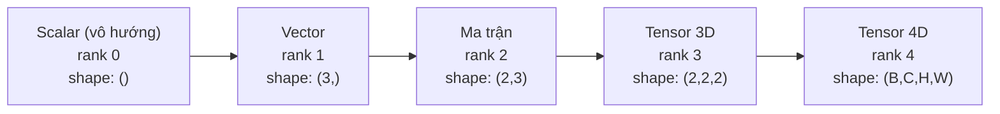
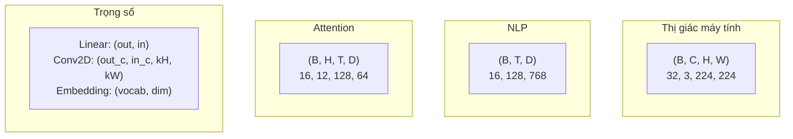
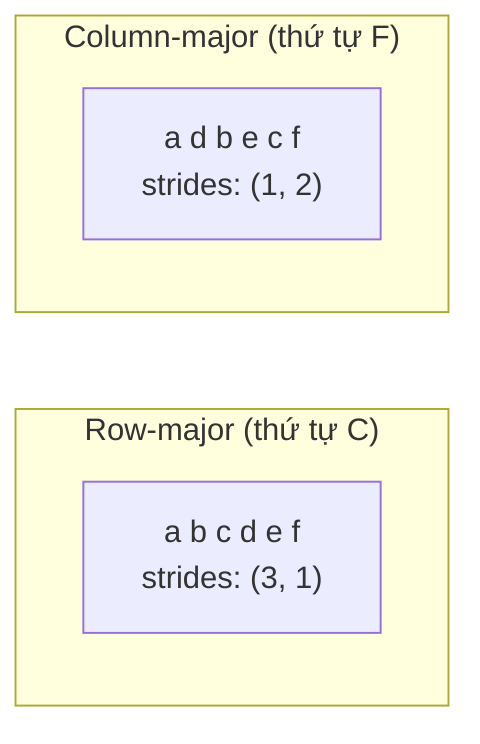
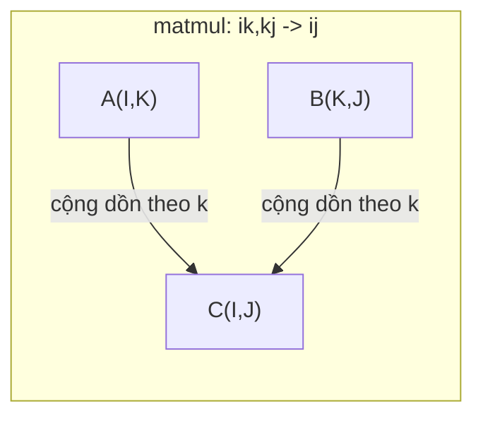

# Các phép toán Tensor (Tensor Operations)

> Tensor là ngôn ngữ chung giữa dữ liệu và deep learning. Mọi ảnh, mọi câu văn, mọi gradient đều chảy qua chúng.

> Bản dịch tiếng Việt của `docs/en.md` để tự học. Thuật ngữ chuyên ngành giữ tiếng Anh trong ngoặc khi cần; code giữ nguyên.

**Loại bài:** Build
**Ngôn ngữ:** Python
**Yêu cầu trước:** Phase 1, Bài 01 (Linear Algebra Intuition), Bài 02 (Vectors, Matrices & Operations)
**Thời gian:** ~90 phút

## Mục tiêu học tập

- Tự cài đặt một lớp tensor có shape, stride, reshape, transpose và các phép toán từng phần tử
- Áp dụng quy tắc broadcasting để tính toán trên các tensor khác shape mà không sao chép dữ liệu
- Viết biểu thức einsum cho tích vô hướng, nhân ma trận, tích ngoài (outer product) và các phép toán theo batch
- Lần theo chính xác shape của tensor qua từng bước của multi-head attention

## Vấn đề

Bạn xây một transformer. Bước forward trông gọn gàng. Bạn chạy và nhận được: `RuntimeError: mat1 and mat2 shapes cannot be multiplied (32x768 and 512x768)`. Bạn nhìn chằm chằm vào các shape. Bạn thử transpose. Giờ nó báo `Expected 4D input (got 3D input)`. Bạn thêm một unsqueeze. Chỗ khác lại hỏng.

Lỗi shape là bug phổ biến nhất trong code deep learning. Về khái niệm chúng không khó — mỗi phép toán có một "hợp đồng" về shape — nhưng chúng nhân lên rất nhanh. Một transformer có hàng chục phép reshape, transpose và broadcast nối tiếp nhau. Sai một trục là lỗi lan dây chuyền. Tệ hơn, có những lỗi shape không hề báo lỗi. Chúng âm thầm cho ra kết quả rác vì broadcast theo sai chiều hoặc cộng dồn theo sai trục.

Ma trận xử lý quan hệ từng cặp giữa hai tập đối tượng. Dữ liệu thật không vừa trong hai chiều. Một batch 32 ảnh RGB kích thước 224x224 là tensor 4D: `(32, 3, 224, 224)`. Self-attention với 12 head cũng là 4D: `(batch, heads, seq_len, head_dim)`. Bạn cần một cấu trúc dữ liệu tổng quát cho số chiều bất kỳ, với các phép toán kết hợp gọn gàng trên mọi chiều. Cấu trúc đó là tensor. Nắm vững các phép toán của nó và lỗi shape sẽ trở nên dễ debug.

## Khái niệm

### Tensor là gì

Tensor là một mảng số nhiều chiều có cùng kiểu dữ liệu. Số chiều được gọi là **rank** (hay **order**, bậc). Mỗi chiều là một **trục (axis)**. **Shape** là một tuple liệt kê kích thước theo từng trục.



Tổng số phần tử = tích của mọi kích thước. Shape `(2, 3, 4)` chứa `2 * 3 * 4 = 24` phần tử.

### Shape tensor trong deep learning

Theo quy ước, mỗi loại dữ liệu ứng với một shape tensor cụ thể.



Ký hiệu: B = batch, C = kênh màu (channel), H/W = chiều cao/rộng, T = độ dài chuỗi, D = số chiều embedding.

PyTorch dùng NCHW (kênh đứng trước). TensorFlow mặc định NHWC (kênh đứng sau). Dùng lệch layout sẽ gây chậm âm thầm hoặc lỗi.

### Cách bố trí bộ nhớ hoạt động

Một mảng 2D trong bộ nhớ thực chất là một dãy byte 1 chiều. **Stride** cho biết cần bỏ qua bao nhiêu phần tử để tiến một bước theo mỗi trục.



Transpose không di chuyển dữ liệu. Nó hoán đổi stride, khiến tensor trở thành **không liên tục (non-contiguous)** — các phần tử của một hàng không còn nằm cạnh nhau trong bộ nhớ.

### Quy tắc broadcasting

Broadcasting cho phép tính toán trên các tensor khác shape mà không sao chép dữ liệu. Căn các shape từ bên phải. Hai chiều tương thích khi chúng bằng nhau hoặc một trong hai bằng 1. Tensor ít chiều hơn được đệm thêm số 1 ở bên trái.

```text
Tensor A:     (8, 1, 6, 1)
Tensor B:        (7, 1, 5)
B sau khi đệm: (1, 7, 1, 5)
Kết quả:      (8, 7, 6, 5)
```

### Einsum: phép toán tensor vạn năng

Phép tổng Einstein (Einstein summation) gán cho mỗi trục một chữ cái. Trục có ở input nhưng không có ở output sẽ bị cộng dồn (sum). Trục có ở cả hai thì được giữ lại.



Các mẫu quan trọng: `i,i->` (tích vô hướng), `i,j->ij` (tích ngoài), `ii->` (vết - trace), `ij->ji` (chuyển vị), `bij,bjk->bik` (nhân ma trận theo batch), `bhtd,bhsd->bhts` (điểm attention).

```figure
tensor-broadcast
```

## Tự xây dựng (Build It)

Code nằm trong `code/tensors.py`. Mỗi bước dưới đây tham chiếu tới phần cài đặt ở đó.

### Bước 1: Lưu trữ tensor và stride

Một tensor lưu một danh sách số phẳng cùng metadata về shape. Stride cho logic đánh chỉ số biết cách ánh xạ chỉ số nhiều chiều sang vị trí trong danh sách phẳng.

```python
class Tensor:
    def __init__(self, data, shape=None):
        if isinstance(data, (list, tuple)):
            self._data, self._shape = self._flatten_nested(data)
        elif isinstance(data, np.ndarray):
            self._data = data.flatten().tolist()
            self._shape = tuple(data.shape)
        else:
            self._data = [data]
            self._shape = ()

        if shape is not None:
            total = reduce(lambda a, b: a * b, shape, 1)
            if total != len(self._data):
                raise ValueError(
                    f"Cannot reshape {len(self._data)} elements into shape {shape}"
                )
            self._shape = tuple(shape)

        self._strides = self._compute_strides(self._shape)

    @staticmethod
    def _compute_strides(shape):
        if len(shape) == 0:
            return ()
        strides = [1] * len(shape)
        for i in range(len(shape) - 2, -1, -1):
            strides[i] = strides[i + 1] * shape[i + 1]
        return tuple(strides)
```

Với shape `(3, 4)`, stride là `(4, 1)` — bỏ qua 4 phần tử để sang hàng tiếp theo, bỏ qua 1 phần tử để sang cột tiếp theo.

### Bước 2: Reshape, squeeze, unsqueeze

Reshape thay đổi shape mà không đổi thứ tự phần tử. Tổng số phần tử phải giữ nguyên. Dùng `-1` cho một chiều để tự suy ra kích thước của nó.

```python
t = Tensor(list(range(12)), shape=(2, 6))
r = t.reshape((3, 4))
r = t.reshape((-1, 3))
```

Squeeze bỏ các trục có kích thước 1. Unsqueeze chèn thêm một trục kích thước 1. Unsqueeze rất quan trọng cho broadcasting — một vector bias `(D,)` cộng vào batch `(B, T, D)` cần được unsqueeze thành `(1, 1, D)`.

```python
t = Tensor(list(range(6)), shape=(1, 3, 1, 2))
s = t.squeeze()
v = Tensor([1, 2, 3])
u = v.unsqueeze(0)
```

### Bước 3: Transpose và permute

Transpose hoán đổi hai trục. Permute sắp xếp lại toàn bộ các trục. Đây là cách chuyển giữa NCHW và NHWC.

```python
mat = Tensor(list(range(6)), shape=(2, 3))
tr = mat.transpose(0, 1)

t4d = Tensor(list(range(24)), shape=(1, 2, 3, 4))
perm = t4d.permute((0, 2, 3, 1))
```

Sau transpose hoặc permute, tensor không còn liên tục trong bộ nhớ. Trong PyTorch, `view` sẽ lỗi với tensor không liên tục — hãy dùng `reshape` hoặc gọi `.contiguous()` trước.

### Bước 4: Phép toán từng phần tử và phép rút gọn

Phép toán từng phần tử (cộng, nhân, trừ) áp dụng độc lập cho từng phần tử và giữ nguyên shape. Phép rút gọn (reduction: sum, mean, max) làm sụp một hoặc nhiều trục.

```python
a = Tensor([[1, 2], [3, 4]])
b = Tensor([[10, 20], [30, 40]])
c = a + b
d = a * 2
s = a.sum(axis=0)
```

Global average pooling trong CNN: `(B, C, H, W).mean(axis=[2, 3])` cho ra `(B, C)`. Mean pooling theo chuỗi trong NLP: `(B, T, D).mean(axis=1)` cho ra `(B, D)`.

### Bước 5: Broadcasting với NumPy

Hàm `demo_broadcasting_numpy()` trong `tensors.py` minh họa các mẫu cốt lõi.

```python
activations = np.random.randn(4, 3)
bias = np.array([0.1, 0.2, 0.3])
result = activations + bias

images = np.random.randn(2, 3, 4, 4)
scale = np.array([0.5, 1.0, 1.5]).reshape(1, 3, 1, 1)
result = images * scale

a = np.array([1, 2, 3]).reshape(-1, 1)
b = np.array([10, 20, 30, 40]).reshape(1, -1)
outer = a * b
```

Tính khoảng cách từng cặp bằng broadcasting: reshape `(M, 2)` thành `(M, 1, 2)` và `(N, 2)` thành `(1, N, 2)`, trừ nhau, bình phương, cộng dồn theo trục cuối, lấy căn bậc hai. Kết quả: `(M, N)`.

### Bước 6: Các phép toán einsum

Các hàm `demo_einsum()` và `demo_einsum_gallery()` đi qua mọi mẫu phổ biến.

```python
a = np.array([1.0, 2.0, 3.0])
b = np.array([4.0, 5.0, 6.0])
dot = np.einsum("i,i->", a, b)

A = np.array([[1, 2], [3, 4], [5, 6]], dtype=float)
B = np.array([[7, 8, 9], [10, 11, 12]], dtype=float)
matmul = np.einsum("ik,kj->ij", A, B)

batch_A = np.random.randn(4, 3, 5)
batch_B = np.random.randn(4, 5, 2)
batch_mm = np.einsum("bij,bjk->bik", batch_A, batch_B)
```

Chi phí tính toán của một phép co (contraction) bằng tích kích thước của mọi chỉ số (cả chỉ số giữ lại lẫn chỉ số bị cộng dồn). Với `bij,bjk->bik`, B=32, I=128, J=64, K=128: `32 * 128 * 64 * 128 = 33,554,432` phép nhân-cộng.

### Bước 7: Cơ chế attention bằng einsum

Hàm `demo_attention_einsum()` cài đặt multi-head attention từ đầu đến cuối.

```python
B, H, T, D = 2, 4, 8, 16
E = H * D

X = np.random.randn(B, T, E)
W_q = np.random.randn(E, E) * 0.02

Q = np.einsum("bte,ek->btk", X, W_q)
Q = Q.reshape(B, T, H, D).transpose(0, 2, 1, 3)

scores = np.einsum("bhtd,bhsd->bhts", Q, K) / np.sqrt(D)
weights = softmax(scores, axis=-1)
attn_output = np.einsum("bhts,bhsd->bhtd", weights, V)

concat = attn_output.transpose(0, 2, 1, 3).reshape(B, T, E)
output = np.einsum("bte,ek->btk", concat, W_o)
```

Mỗi bước đều là một phép toán tensor: chiếu (matmul qua einsum), tách head (reshape + transpose), điểm attention (matmul theo batch qua einsum), tổng có trọng số (matmul theo batch qua einsum), gộp head (transpose + reshape), chiếu output (matmul qua einsum).

## Dùng thư viện (Use It)

### Tự viết vs NumPy

| Phép toán | Tự viết (lớp Tensor) | NumPy |
|---|---|---|
| Tạo | `Tensor([[1,2],[3,4]])` | `np.array([[1,2],[3,4]])` |
| Reshape | `t.reshape((3,4))` | `a.reshape(3,4)` |
| Transpose | `t.transpose(0,1)` | `a.T` hoặc `a.transpose(0,1)` |
| Squeeze | `t.squeeze(0)` | `np.squeeze(a, 0)` |
| Sum | `t.sum(axis=0)` | `a.sum(axis=0)` |
| Einsum | Không có | `np.einsum("ij,jk->ik", a, b)` |

### Tự viết vs PyTorch

```python
import torch

t = torch.tensor([[1, 2, 3], [4, 5, 6]], dtype=torch.float32)
t.shape
t.stride()
t.is_contiguous()

t.reshape(3, 2)
t.unsqueeze(0)
t.transpose(0, 1)
t.transpose(0, 1).contiguous()

torch.einsum("ik,kj->ij", A, B)
```

PyTorch bổ sung autograd, hỗ trợ GPU và các kernel BLAS tối ưu. Ngữ nghĩa shape thì giống hệt. Nếu bạn hiểu bản tự viết, lỗi shape trong PyTorch sẽ trở nên dễ đọc.

### Mọi lớp mạng nơ-ron đều là phép toán tensor

| Phép toán | Dạng tensor | Einsum |
|---|---|---|
| Lớp Linear | `Y = X @ W.T + b` | `"bd,od->bo"` + bias |
| Attention QKV | `Q = X @ W_q` | `"btd,dh->bth"` |
| Điểm attention | `Q @ K.T / sqrt(d)` | `"bhtd,bhsd->bhts"` |
| Output attention | `softmax(scores) @ V` | `"bhts,bhsd->bhtd"` |
| Batch norm | `(X - mu) / sigma * gamma` | từng phần tử + broadcast |
| Softmax | `exp(x) / sum(exp(x))` | từng phần tử + rút gọn |

## Sản phẩm (Ship It)

Bài này tạo ra hai prompt dùng lại được:

1. **`outputs/prompt-tensor-shapes.md`** — Prompt có hệ thống để debug lỗi lệch shape tensor. Có bảng quyết định cho mọi phép toán phổ biến (matmul, broadcast, cat, Linear, Conv2d, BatchNorm, softmax) và bảng tra cách sửa.

2. **`outputs/prompt-tensor-debugger.md`** — Prompt debug từng bước để dán vào bất kỳ trợ lý AI nào khi một lỗi shape đang chặn bạn. Đưa vào thông báo lỗi và shape tensor của bạn, nhận lại cách sửa chính xác.

## Bài tập

1. **Dễ — Reshape vòng tròn.** Lấy một tensor shape `(2, 3, 4)`. Reshape thành `(6, 4)`, rồi `(24,)`, rồi về lại `(2, 3, 4)`. Kiểm chứng thứ tự phần tử được giữ nguyên ở mỗi bước bằng cách in dữ liệu phẳng.

2. **Trung bình — Cài đặt broadcasting.** Mở rộng lớp `Tensor` với phương thức `broadcast_to(shape)` để giãn các chiều kích thước 1 cho khớp shape đích. Rồi sửa `_elementwise_op` để tự động broadcast trước khi tính. Kiểm tra với shape `(3, 1)` và `(1, 4)` cho ra `(3, 4)`.

3. **Khó — Tự xây einsum.** Cài đặt hàm `einsum(subscripts, *tensors)` cơ bản xử lý được ít nhất: tích vô hướng (`i,i->`), nhân ma trận (`ij,jk->ik`), tích ngoài (`i,j->ij`) và chuyển vị (`ij->ji`). Phân tích chuỗi chỉ số, xác định các chỉ số bị co và lặp qua mọi tổ hợp chỉ số. So sánh kết quả với `np.einsum`.

4. **Khó — Theo dõi shape trong attention.** Viết hàm nhận `batch_size`, `seq_len`, `embed_dim` và `num_heads`, in ra shape chính xác ở mọi bước của multi-head attention: input, chiếu Q/K/V, tách head, điểm attention, trọng số softmax, tổng có trọng số, gộp head, chiếu output. Đối chiếu với output của `demo_attention_einsum()`.

## Thuật ngữ chính

| Thuật ngữ | Người ta hay nói | Thực chất nghĩa là |
|---|---|---|
| Tensor | "Ma trận nhưng nhiều chiều hơn" | Mảng nhiều chiều có kiểu dữ liệu đồng nhất cùng shape, stride và các phép toán xác định |
| Rank | "Số chiều" | Số trục. Ma trận có rank 2 — khác với "hạng ma trận" (matrix rank) ở bài 01 |
| Shape | "Kích thước tensor" | Tuple liệt kê kích thước theo từng trục. `(2, 3)` nghĩa là 2 hàng, 3 cột |
| Stride | "Cách bố trí bộ nhớ" | Số phần tử cần bỏ qua để tiến một vị trí theo mỗi trục |
| Broadcasting | "Shape khác nhau vẫn tự chạy" | Một bộ quy tắc chặt: căn từ phải, các chiều phải bằng nhau hoặc một bên bằng 1 |
| Contiguous (liên tục) | "Tensor bình thường" | Các phần tử lưu tuần tự trong bộ nhớ, không có khoảng trống hay bị sắp lại so với bố cục logic |
| Einsum | "Cách viết matmul cho màu mè" | Ký hiệu tổng quát biểu diễn mọi phép co tensor, tích ngoài, vết hoặc chuyển vị trong một dòng |
| View | "Giống reshape" | Tensor dùng chung vùng nhớ nhưng có metadata shape/stride khác. Lỗi với dữ liệu không liên tục |
| Contraction (phép co) | "Cộng dồn theo một chỉ số" | Phép toán tổng quát nhân rồi cộng dồn theo chỉ số chung giữa các tensor, cho kết quả có rank thấp hơn |
| NCHW / NHWC | "Định dạng PyTorch vs TensorFlow" | Quy ước bố trí bộ nhớ cho tensor ảnh. NCHW đặt kênh trước các chiều không gian, NHWC đặt sau |

## Đọc thêm

- [NumPy Broadcasting](https://numpy.org/doc/stable/user/basics.broadcasting.html) — Các quy tắc chuẩn kèm ví dụ trực quan
- [PyTorch Tensor Views](https://pytorch.org/docs/stable/tensor_view.html) — Khi nào view hoạt động và khi nào nó sao chép
- [einops](https://github.com/arogozhnikov/einops) — Thư viện giúp reshape tensor dễ đọc và an toàn
- [The Illustrated Transformer](https://jalammar.github.io/illustrated-transformer/) — Trực quan hóa shape tensor chảy qua attention
- [Einstein Summation in NumPy](https://numpy.org/doc/stable/reference/generated/numpy.einsum.html) — Tài liệu einsum đầy đủ kèm ví dụ
